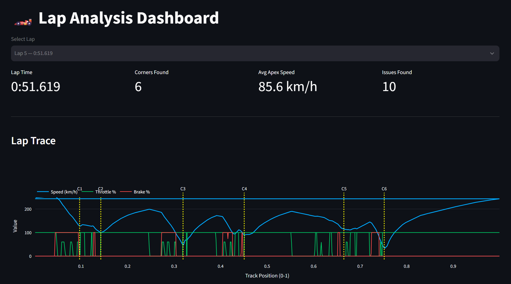
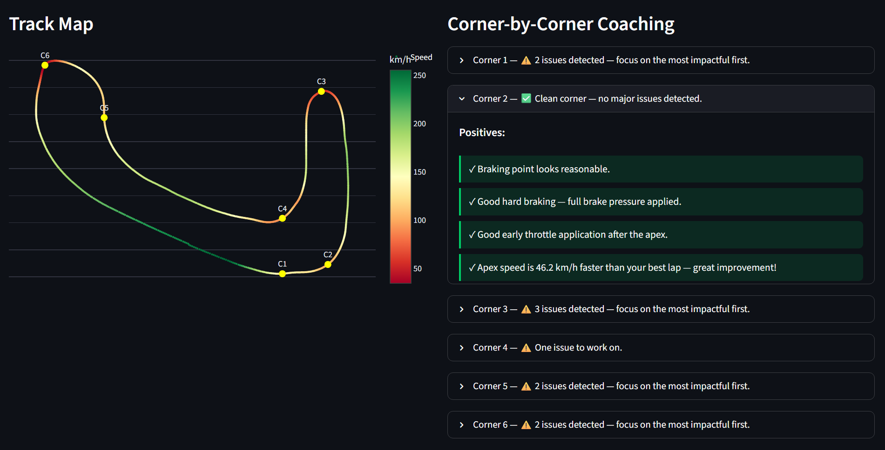
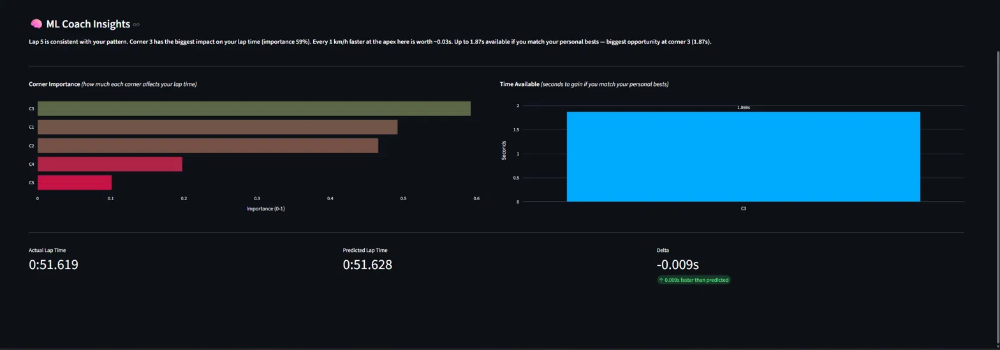

# AC Lap Analyzer

A real-time telemetry pipeline and ML coaching system for **Assetto Corsa** - reads live simulator data, detects corners, tracks lap performance, and delivers machine-learning-powered coaching insights across sessions.

## Features

- **20 Hz real-time telemetry ingestion** via Windows shared memory (mmap) - sub-50ms latency, reads directly from the simulator process
- **Custom corner detection algorithm** - 3-pass steering-angle segmentation with gap-merge to correctly identify physical corners across all laps
- **ML coaching layer** - NumPy linear regression + anomaly detection pooled across sessions; ranks corners by explained variance and predicts lap time gains
- **Cross-session persistence** - per-corner feature vectors serialized to JSON so the model sharpens over time
- **Streamlit dashboard** - live track map, lap overlays, corner coaching cards, session leaderboard, cross-session ML insights

## ML Coach Insights

After 5+ laps on a car/track combo (across any number of sessions), the ML coach unlocks:
- **Corner importance ranking** - which corners explain the most lap time variance
- **Personal best targets** - how much time is available if you hit your best in every corner
- **Anomaly detection** - flags corners that were significantly worse than your average

## Setup

Requirements: Windows, Python 3.9+, Assetto Corsa with Shared Memory enabled (Settings > General > Enable Shared Memory)

## Install

    git clone https://github.com/jusli04/ac-lap-analyzer.git
    cd ac-lap-analyzer
    python -m venv venv
    venv\Scriptsctivate
    pip install -r requirements.txt

## Run

    python record.py            # record a session
    streamlit run dashboard.py  # view dashboard

## Gamification

The app includes a progression system to keep you coming back:

- **Daily streak** - drive every day to keep your streak alive (like Snapchat)
- **XP + Levels** - earn XP for every lap, session, and personal best. Level up from Rookie to The Surgeon
- **Challenges** - beat personal bests, hit consistency targets, unlock ML coach, and more
- **Titles** - Rookie → Hot Lap Hunter → Apex Chaser → Corner Surgeon → The Surgeon

## Background

Built to explore low-level systems programming (Windows IPC via shared memory), algorithm design (corner segmentation), and applied ML on real sensor data - the same kinds of high-frequency telemetry streams found in real automotive and robotics systems.
